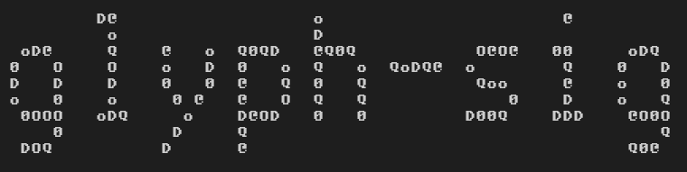

# glyph-sig



Want cryptographic security but miss the days of hand-signed letters and
wax seals? Tired of staring at `a7f3b9c1...` and pretending you can tell
it apart from `a7f3b9c2...`? What if your document signature was
something you could actually *look at* — your name, rendered in living
texture that shifts and shimmers differently for every document you sign?

glyph-sig turns document signatures into deterministic ASCII art.

The signer's name is rendered as large block letters using a BDF bitmap
font. The fill characters that make up each letter encode a real Ed25519
cryptographic signature, the signer's public key, and a timestamp — all
embedded directly in the visual texture. The name is always
human-readable, but the pattern of characters changes if even a single
byte of the document changes.

The signature itself is the verification artifact — no separate hash or
key file needs to be transmitted. A verifier extracts the fill characters
in reading order, recovers the embedded Ed25519 signature, public key,
and timestamp, and verifies the signature against the document.

## Install

```
pip install .
```

Requires Python 3.10+, [bdfparser](https://pypi.org/project/bdfparser/),
and [cryptography](https://pypi.org/project/cryptography/).

## An example

Here's a signature which signs the document document.txt in this repo, with
the name 'cybermaggedon':

```
                   !                                                                            ?
                   :                                                                            ?
                   *                                                                            :
  ~=+%    !    #   ? ~@#     ;?/:    @ #^?    .!. $%    *;+=     #+! #    ~*$ :    @:@@     *$/ .    ^?.!    # !%$
 *    ^   *    *   %/   ~   =    =    $   /   @  +  .       @   /   +    $   @    ;    $   #   =    &    :   ~~   /
%        :    !    ^    $   @^**;     +       /  ;  .  ^=!??   %   *    ^   +     @.+:$   /    ~    =    ?   ?    $
$        =   =/   &    =   *         #       #  ;  *  ?    @    #?*      &#!     %        =    @   ;    $   %    ?
@    $    .~^ &   .*   %   ^    %    /       =  @  %  $   ~*   @        ;        +    $   ;   /#   .    ^   ?    ~
 :.!@         ;   # !#!     +~/.     =       :     :   @!# #    ####     ##*;     .&%;     ??: ~    *%;$    ~    =
         =    %                                                ?    *   :    &
          /=~:                                                  //*@     :!$.
```

You will be able to use this code to verify the document with this signature.
To do this you would copy the above signature to sig.txt.  You verify the
document with the signature:

```
$ glyph-sig verify document.txt sig.txt -n "cybermaggedon" -k cybermaggedon.pub
VALID: cryptographic signature verified.
Signed by key: psEMYwslGtLB344/YuJFEthhp9pA/sifsaCwt4T1mRs=
Signed at:     2026-11-10T14:31:40+00:00
```

This checks the following things:
- That the signature was used to sign contents of document.txt: If you change
  document.txt, the signature will fail to verify.
- That the signature was signed with the name 'cybermaggedon': Try a
  different name and it will fail.
- That the internal cryptographic signature was signed by the key with the
  public key contained within the signature.
- That the public key used to sign is the same as that contained in
  cybermaggedon.pub.

Note: One VERY IMPORTANT THING: If you don't specify the public key in
verification, then there's no check that the signer key matches that in the
signature.

## Quick start

Generate a keypair:

```
$ glyph-sig keygen -o mykey
Private key: mykey
Public key:  mykey.pub
```

Sign a document with your private key:

```
$ echo hello world > document.txt
$ glyph-sig sign document.txt -n "Fred Bloggs" -k mykey -p alnum > sig.txt
```

The signature art embeds the Ed25519 signature, your public key, and a
timestamp. Verify it — the signature is the proof:

```
$ cat sig.txt | glyph-sig verify document.txt - -n "Fred Bloggs" -p alnum
VALID: cryptographic signature verified.
Signed by key: 0aFrjVDunoI6uYojLv589g0VNwwuak0HKjd2hZSS5Yo=
Signed at:     2026-11-10T14:20:08+00:00
```

Verify against a known public key:

```
$ cat sig.txt | glyph-sig verify document.txt - -n "Fred Bloggs" -p alnum -k mykey.pub
VALID: cryptographic signature verified.
Signed by key: 0aFrjVDunoI6uYojLv589g0VNwwuak0HKjd2hZSS5Yo=
Signed at:     2026-11-10T14:20:08+00:00
```

Print a key's ID (matches the base64 shown during verification):

```
$ glyph-sig keyid mykey.pub
0aFrjVDunoI6uYojLv589g0VNwwuak0HKjd2hZSS5Yo=
```

Wrong document or wrong name fails:

```
$ cat sig.txt | glyph-sig verify pyproject.toml - -n "Fred Bloggs" -p alnum
INVALID: signature does not match document.
```

## Entropy

Check how many effective bits a name/font/palette combination provides:

```
$ glyph-sig bits -n "Fred Bloggs"
712
```

The name must provide enough fill pixels to encode the 104-byte crypto
payload (64 signature + 32 public key + 8 timestamp). The number of
pixels needed depends on the palette: ~145 with `alnum`, ~149 with
`alpha`, ~204 with `symbols`. If a name is too short,
signing will fail with an error suggesting a longer name, larger font, or
bigger palette.

## Fonts

Several public-domain BDF bitmap fonts are bundled. List them:

```
$ glyph-sig fonts
```

The default font is `8x13O`. Use `-f` to select another by name
(extension optional) or by path:

```
$ glyph-sig sign document.txt -n "Fred Bloggs" -f 6x13
```

Larger fonts produce more filled pixels and therefore higher entropy per
character. Smaller fonts are more compact but may require longer names to
meet the minimum bit threshold.

Example with `6x13`:

```
$ glyph-sig sign document.txt -n "Fred Bloggs" -f 6x13

&@~!^                    @    *.@;    :*
?                        /     ~  .    .
~                        ;     /  :    :
=      + ?#    ;&?    /$+/     !  %    ?     /#%    /+%    &#*    %&@
+.^/   !~  ^  ^   #  ~   ;     :;#     #    /   ~  *   .  @   +  /   /
^      =      /*/@:  +   ?     &  ;    *    .   .  @   .  ;   /   @~
?      ;      .      !   .     &  .    #    .   %  &   *  /   &     $
/      &      .   *  ?   .     ?  !    &    !   =   &.*=   !?.@  =   ~
!      &       $@$    =&~~    /~@&    @?*    ;$%       *      .   @=^
                                                   %   ~  :   ~
                                                    =+&    #^+
```

## Palettes

Four fill character palettes are available via `-p`:

| Name      | Characters                                               |
|-----------|----------------------------------------------------------|
| `symbols` | `#@%&/=*+~:;!?$^.` (default)                            |
| `simple`  | `oO0DQ@`                                                 |
| `alpha`   | Mixed-case letters (ambiguous characters excluded)       |
| `alnum`   | Letters + digits (ambiguous characters excluded)         |

Larger palettes encode more bits per pixel and require fewer fill pixels
for cryptographic mode. `alnum` and `alpha` are recommended for crypto
signing.

## How it works

1. The document is hashed with SHA-256.
2. A signing message is constructed: `sha256(document_hash || name || timestamp)`.
   This binds the document, signer name, and timestamp together.
3. The signing message is signed with the signer's Ed25519 private key,
   producing a 64-byte signature.
4. The signature (64 bytes), public key (32 bytes), and timestamp
   (8 bytes) are concatenated into a 104-byte payload.
5. The payload is treated as a big integer and base-converted into
   palette character indices. These fill the rendered name's pixels in
   reading order. Any remaining pixels are filled with PRNG-derived
   characters for visual consistency.
6. Verification extracts all non-space characters from the art in
   reading order, recovers the 104-byte payload, and verifies the
   Ed25519 signature against the reconstructed signing message. The
   signature is robust to whitespace changes (copy/paste, reformatting).

## Library usage

```python
from bdfparser import Font
from glyph_sig import render_crypto_signature, verify_crypto_signature, hash_document

font = Font("path/to/font.bdf")
hex_hash = hash_document("document.txt")

with open("mykey", "rb") as f:
    private_pem = f.read()

art = render_crypto_signature("Fred Bloggs", hex_hash, private_pem, font, "alnum")
valid, pubkey, timestamp = verify_crypto_signature(art, "Fred Bloggs", hex_hash, font, "alnum")
assert valid
```

## License

Apache License 2.0. See [LICENSE](LICENSE).

Bundled fonts are public domain. See `glyph_sig/fonts/LICENCE.txt`.
